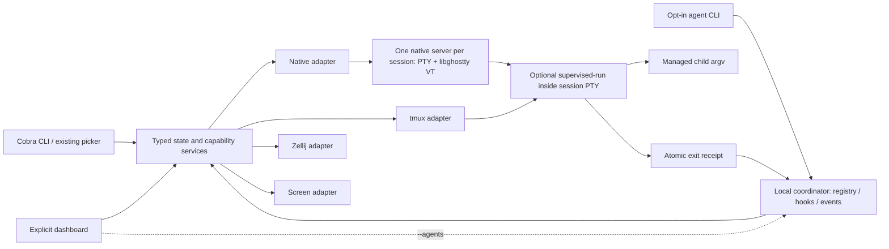

# Architecture and implementation boundaries

Status: M1/M2 architecture and Phase 6 Linux dashboard implementation.
CLI failures, native runtime, typed backend reads, public JSON, host identity and
bounded output, profiles, opt-in managed runtime, hooks, events, waits and explicit
notification actions and a separate M3 dashboard are implemented. Inherited M1/M2
platform release gates remain blocked and the
matrix below is a conservative target, not platform certification.
Baseline: `f2606d240912ffa2269569cd642a7f83e5457f74`.

## Components

Ordinary session commands remain daemonless apart from existing native session
servers. They must not start, dial, await or poll the agent coordinator. The
dashboard and CLI use the same state services; neither parses another CLI's human
output. Native retains libghostty for terminal state and the existing PTY package.
This project does not implement a terminal renderer or recreate mux layouts.

## Package seams and PR order

| Boundary | Implementation owner | First PR |
| --- | --- | --- |
| Error propagation, diagnostics, config policy | `pkg/cmd`, `pkg/logger`, `pkg/config` | 1A |
| Framing and transport limits | new `pkg/nativeprotocol` without CGO | 1B |
| Private runtime directory, locks, peer checks | new `pkg/runtimepath` with Unix-specific helpers | 1B |
| PTY/VT ownership and connection lifecycle | `pkg/cmd/server.go`, extracted helpers as needed | 1B/1C |
| Data-only types, typed errors, locators, capabilities | new `pkg/core` | 2A |
| Backend contexts, exact resolution, capture | existing `pkg/backend` adapters | 2A/2B |
| JSON rendering, error-to-exit mapping | `pkg/cmd`, using `pkg/core` errors | 2B |
| Profile validation/compile/apply | `pkg/config/profile.go`, `pkg/cmd/profile.go` | 3A |
| Structured launch manifests, foreground child ownership and receipts | `pkg/supervisor`, `internal supervised-run`, backend managed launcher | 4A |
| Registry, local IPC, reconciliation and agent CLI | `pkg/agent`, `pkg/localipc`, `pkg/cmd/agent.go` | 4B |
| Hook intake, bounded event broker, wait and notification subscription | `pkg/agent`, `pkg/cmd/agent_signals.go` | 5 |

These are boundaries, not a requirement for a broad refactor. Preserve interface
wrappers while migrating callers. The Phase 0 PATH wrapper is a test seam for all
baseline external invocations; production adapters need no test-only global flag.
Tests build an actual txm executable because native creation relaunches it.

## Baseline backend behavior and intended limits

The following is a conservative starting matrix, **not runtime certification**.
`conditional` requires version-specific isolated evidence before being advertised.

| Operation | Native M1 | tmux M1 | Zellij | GNU Screen |
| --- | --- | --- | --- | --- |
| Session create/list/attach/delete | repair IPC/lifecycle | exact server/session target | conditional | conditional; retain full server ID |
| Read-only attach | connection observer role | verified `attach-session -r` | unsupported until proven | unsupported until proven |
| Screen snapshot | bounded VT capture | bounded pane capture | unsupported until proven | unsupported until proven |
| Historical output | unsupported until bounded VT history API is proven | conditional capture range | unsupported | unsupported |
| Window/pane/layout targeting | unsupported | IDs returned by backend | unsafe focus operations rejected | unsafe/ignored target arguments rejected |
| Working directory | direct child cwd | create/split cwd | conditional | conditional |
| Managed launch (M2) | supervised wrapper | supervised wrapper | unsupported until proven | unsupported until proven |

Placeholder preview strings are UI messages, not successful snapshots. A command
being present in a backend CLI does not establish safe targeting or support.
Native Windows persistence is unsupported until PTY/transport runtime tests exist;
cross-compilation alone does not change that. Linux and macOS are required M1
native targets; unavailable macOS hardware blocks its release claim, not Linux work.

## Native server ownership

The server owns its child, PTY, VT state, listener, instance lock and client queues.
One goroutine consumes PTY output; VT writes/snapshots/resizes serialize under a
short state lock. Each client has a bounded queue and a single socket writer.
Never perform client socket writes under the VT or client-list lock. Snapshots
and subsequent output have an ordered handoff; overflow disconnects that client.

The server starts only after acquiring the exact session-name lock, then starts
the PTY child and advertises an instance handshake. Socket existence is not
readiness. Failed exec and a child exiting before readiness must be distinguished
from a live persistent session. The parent cannot claim success from a different
server winning a duplicate-name race. See [native-protocol.md](native-protocol.md).

Shutdown closes intake, terminates the owned child process group with a finite
grace period, reaps it, stops connection workers and joins the PTY reader before
closing VT/log state. Natural child exit drains available output, then terminates
the server. Attach cancellation stops resize subscriptions and local input work,
restores TTY state, and preserves the detached server/child. An observer may use
the local detach key but cannot change shared PTY dimensions.

## Paths, identity and permissions

Existing config file search stays unchanged in M1: `~/.txm/config`, then
`~/.txm/config.txt`, then `~/.txmrc`. New state honors absolute `XDG_STATE_HOME`,
otherwise `~/.local/state`, under `txm/v1`. New runtime paths are specified in the
protocol document. Directories are owned by the effective user with mode 0700;
state, manifests, receipts and locks are 0600. Reject wrong ownership, symlinks
at private path components and unsafe permissions; do not repair foreign paths.

First structured use atomically creates a random 128-bit `host_id`, persisted
with no overwrite of an existing identity. Concurrent first use converges on one
valid file through an exclusive lock and atomic write. Fsync file and parent
directory where supported. Corrupt identity is an error, never silently regenerated.

An unmanaged session has only `{host_id, backend, name}` and backend identity at
observation time. A name is reusable. M2 managed entities get a persisted random
128-bit `managed_id`; every launch also gets a different random `instance_id`.
Rename updates a locator, never those IDs. Native transport instance IDs do not
turn ordinary sessions into managed agents. PIDs are observations tied to an
instance, never durable identity.

## M2 supervisor and coordinator ownership

The coordinator is opt-in, per-user and local-only. It is the sole writer of
registry/state snapshots. Hook clients submit signals, never edit registry files.
The supervised wrapper is the sole writer of its launch's final receipt. Ordinary
M1 mutations do not become registry writers: opted-in reconciliation handles
renames/deletes through coordinator requests or later discovery.

Launch sequence: coordinator allocates entity/instance IDs and records launch intent;
the launcher writes a private one-use argv/cwd manifest; the backend starts the
fixed txm wrapper inside the session PTY; the wrapper consumes the manifest,
executes/reaps the child, atomically writes its receipt and best-effort notifies
the coordinator. User argv never enters interpolated shell text. For mux APIs
requiring shell text, quote only the fixed executable and validated opaque ID.

On restart the coordinator reloads registry and receipts and validates instance
liveness. A short-lived session can disappear before discovery while its receipt
still proves exit. Missing receipts after wrapper/server SIGKILL mean unknown;
they do not prove exit 0. No automatic relaunch. A coordinator crash must not kill
the wrapper, PTY server or managed child. Registration of an existing session is
unsupervised and cannot create retroactive exit receipts.

Lifecycle, client attachment, agent attention and turn completion are separate
fields. Hooks require opted-in registration, token/instance association and
freshness checks. Same-UID processes remain within the trust boundary; neither
observer roles nor private tokens sandbox a malicious process owned by that user.
M2 wire schemas are specified in [contracts](contracts.md), with provider versions,
primary sources and runtime limits in [M2 readiness](m2-readiness.md).

Events are ephemeral metadata notifications with coordinator epoch and sequence.
Overflow/reconnect/epoch changes require resync to a fresh snapshot. No replay or
exactly-once claim. Wait combines snapshot/subscription with bounded reconciliation
to avoid missed transitions. Notifications default off; ordinary commands do not
poll agents. No transcript retention, prompts, environment values or raw argv in
registry/events/logs by default. Existing explicit native `--log` remains opt-in.

## Initial resource limits and measurements

Native limits and timeouts are normative in the protocol document. CLI captures
are bounded during collection to 1 MiB. Backend requests default to five seconds;
interactive attach has a bounded handshake but no overall lifetime limit.
Cancellation must terminate an external query and reap its process.

The small-fixture baseline records startup/list/attach latency, PTY throughput
and server RSS. Scale and dashboard thresholds are established before their
release gates. Measurements and unsupported hosts belong in testing evidence;
do not infer performance from a build or invent missing measurements.

## Decision log

- Phase 4: the new explicit request authorizes Linux development while the M1
  cross-platform release gate remains blocked. Preserve every platform limit;
  no M1/M2 release, Phase 5 features or publishing is implied.
- Phase 4: manifests use structured argv/cwd and environment-variable names;
  only a fixed launcher executable and opaque instance ID enter backend launch
  arguments. The wrapper filters its inherited backend environment. Values are
  not synchronized from each client or persisted in registry/receipts.
- Phase 4: wrapper-owned immutable receipts and current child-status IPC survive
  coordinator loss without PID-based recovery guesses. The child has a separate
  foreground PTY process group; termination uses bounded group cleanup before
  reaping, preserving the child identity until the last signal. Terminal loss
  or a killed wrapper may prevent a receipt, which remains unknown.
- Phase 4: coordinator owns both runtime singleton and state-writer locks, plus
  random-epoch discovery/socket identity. Clients serialize automatic startup;
  requests bind both persisted host ID and validated state-root location so a
  different XDG_STATE_HOME cannot use the wrong registry, even with a copied ID.
  shutdown cleans only the matching socket inode. Native launch instances and
  tmux environment ownership markers bind records across rename/name reuse.
  Existing-session registration does not allocate a supervised session identity.
- Phase 4: a persisted pre-launch intent can have no backend binding. Restart
  reports it as unknown and discards an unused one-use manifest under its free
  instance lock; it never replays a launch. Corrupt state is an error. Registry
  writes are atomic; Linux immutable publication uses renameat2/NOREPLACE to
  avoid a temporary multi-link receipt. The macOS path remains unverified.
- Phase 4: reconciliation is request-driven, with finite frames, clients and
  deadlines, not a background polling loop. Ordinary M1 commands never access
  the coordinator. Attention has a separate unavailable source and null timestamp
  until verified Phase 5 hooks; no terminal-output inference is introduced.

- 2026-10-29: keep four adapters; capabilities express differences rather than
  emulating unsupported panes/windows. Native keeps its current VT dependency.
- 2026-10-29: move protocol to a separate namespace; leave legacy paths and active
  servers untouched. New clients never probe them with framed requests.
- 2026-10-29: freeze M1 contracts first; defer provider-specific hook APIs to 5A.
  Fix M1/M2 gate cycles in the ledger without reducing mandatory goals.
- 2026-10-29: use a guarded PATH wrapper for Phase 0 to cover the baseline's
  scattered external invocations without refactoring production backends early.
- 2026-10-29: pin one full Ghostty revision and exact Zig version for local,
  CI and release builds; reject dirty/mismatched source instead of resetting it.
- 2026-10-29: the old `d4c88d806` pin builds with Zig 0.16.0 but txm's existing
  Go binding fails CGO compilation (missing render-state overscan/row-ID and OSC
  API symbols). Align Ghostty with `36ec90a07fcb58e3033296c06c82438bf30d2e42`, the
  exact `GIT_TAG` in the binding's `CMakeLists.txt` at
  `c1ee3183994d21df2b9eae4f11336aca2da1e8e6`; its `flake.nix` selects Zig 0.16.0.
  Keep `go.mod` unchanged. Preserve the user's existing old Ghostty checkout.

- Phase 1: observe child exit with POSIX waitid/WNOWAIT and reap only after the
  final process-group signal. Reaping first permits PID/PGID reuse before group
  cleanup; a small CGO helper uses the CGO toolchain already required by native VT.
  Readiness and live status use a nonblocking kernel observation as well; a delayed
  notification goroutine cannot turn an already exited child into a live session.
- Phase 1: cancel and join client, PTY input and output workers before closing
  their numeric file descriptor, VT or log state. This prevents descriptor reuse
  while a worker still holds the old number. Snapshot/attach/resize lock waits
  and streaming capture share the request deadline.
- Phase 1: keep name-lock inodes stable across restarts; stream directory entries
  instead of counting accumulated locks against the live-socket limit. Stale
  sockets are retained, not guessed at or blindly removed.
- Phase 1: native contexts are bound to a CLI invocation through the compatibility
  manager; Phase 2 still introduces explicit context-aware contracts for all
  adapters. Native attach polls input, restores file flags/TTY state, and stops
  resize notifications instead of leaving a stdin goroutine behind.
- Phase 1: VT snapshot output is bounded while formatting; empty byte content is
  a base64 string. Limit resize to 4096 per axis and 1,048,576 total cells; roll
  VT geometry back if the PTY resize fails. Input queues are bounded independently.
- Phase 1: use libghostty query replies for detached/observer-only sessions; with
  a live control terminal, preserve raw query/reply passthrough without injecting
  an additional emulator reply. This adds no renderer or custom escape parser.
- Phase 1: same-UID connection roles are enforced on every operation, rather than
  relying on a client's read-only flag. Explicit native logs require owned,
  mode-0600 regular files; symlinks, hard links and FIFO paths are rejected.
- Phase 2: keep action compatibility wrappers while `core.Reader` owns typed,
  context-aware sessions, exact lookup, capabilities, windows, panes and captures.
  CLI renders these observations; unsupported previews are UI messages only.
- Phase 2: resolve external executable paths once and use those same paths for
  every invocation. Bound stdout, stderr, query time and pipe-drain time. tmux
  verifies a compatible 3.x version, batches list metadata, resolves IDs within
  the requested session/window, and refuses name/index ambiguities. Runtime
  certification here is tmux 3.4. Printable metadata separators avoid tmux's
  replacement of control characters in pane-list formatting.
- Phase 2: tmux literal-key mode still strips terminal semicolons in argv. Encode
  input as bounded hex-byte batches and deliver Enter separately; verify leading
  dashes, key names, Unicode and separator characters on a real PTY reader.
- Phase 2: Screen retains full PID.name identities; duplicate short names are
  conflicts. Screen/Zellij exact pane/layout operations fail before any command
  or focus change. Their installed-version runtime remains unverified. Sources:
  [Screen invocation manual](https://www.gnu.org/software/screen/manual/html_node/Invoking-Screen.html)
  and [Zellij CLI definitions](https://docs.rs/zellij-utils/latest/src/zellij_utils/cli.rs.html).
- Phase 2: local host identity is a separately generated random ID, private and
  atomically published with a stable lock; errors never regenerate corrupt state.
  It is initialized for structured-state reads, not picker previews or mutations.
  Native launch instances and future managed identities remain distinct.
- Phase 2: plain snapshots strip ECMA-48/C1 controls and incomplete UTF-8 before
  final bounds. Raw snapshots require opt-in and use base64 in JSON. Legacy dump
  now shares these safe limits. Line-limited native snapshots disclose truncation.
  Signal cancellation takes exit 130 precedence even over aggregate partial data.
- Phase 3: strict bounded TOML decoding and a backend-specific compiler validate
  all names, cwd, shapes, splits, command limits and layouts before mutation.
  Dry-run never discovers sessions or initializes runtime/host identity. Native
  profiles use one terminal; Screen/Zellij profiles are explicitly unsupported.
- Phase 3: tmux 3.4+ profiles capture creation IDs and add a random session
  ownership token. Queue-local format guards check token/session/window/pane
  identity and reject linked windows before mutation; cleanup never resolves a
  resource by name. Cancellation uses a fresh bounded cleanup context. Missing
  receipts or lost ownership leave uncertain resources intact with partial error.
- Phase 3: launch the invocation shell explicitly at each requested cwd, build
  every pane/layout first, then send terminal input to the returned pane IDs.
  Disable synchronization on new panes and refuse ordinary exact input while
  synchronization is enabled, rechecking it in the server queue before each write.
  Accepted input is not supervised completion.
- Phase 3: native profile startup supplies cwd directly to the owned server
  process; attach/rollback target its authenticated random instance. Reject
  relative native TMPDIR, which would change meaning after moving cwd.
- Phase 3: release pkg-config paths are absolute through `TXM_RELEASE_ROOT`;
  dependency and Go caches must match the target ABI. Archive smoke uses matching
  GNU/musl target libraries, separately from the host development library. Archive rules include the
  man page and generated completions. Deprecated keys follow
  [GoReleaser's migration notices](https://goreleaser.com/resources/deprecations/).
  These checks do not certify unrun platform archives or authorize publishing.

## Phase 5 state and event ownership

The coordinator remains the sole registry writer. Wrappers publish immutable
receipts; explicit hook clients allocate only private sequence cursor files under
generation locks. Credentials bind registration, instance and rotating generation;
their 256-bit token stays in a private file. Hook input contributes sourced,
expiring attention and optional turn completion, never process lifecycle.

The coordinator gate serializes snapshot creation and subscription registration.
Each of at most eight subscribers has a nonblocking 16-event queue. Overflow
invalidates that queue and produces a fresh snapshot. There is no replay log.
Short requests retain a separate 16-client budget. Event writers have two-second
deadlines. Reconciliation sleeps with no subscribers; active subscriptions share
a 500 ms timer and one-second heartbeats. Stream cancellation closes the socket.
Wait and optional notifications consume the same snapshots/events; notification
actions have their own bounded local queue and cannot stall coordinator fanout.

## Phase 6 dashboard decisions

The new request authorizes Linux development while retaining M1/M2 platform
release blockers. `pkg/dashboard` owns model/rendering/input and bounded workers;
`pkg/cmd/dashboard.go` adapts existing typed core.Reader and agent.Stream APIs.
`pkg/backend/dashboard.go` revalidates transient session observations and pins
native instance handshakes for capture/attach. It reuses the existing framed
snapshot decoder. Public M1/M2 schemas do not change. Registrations and sessions
remain separate because names cannot establish a managed binding.

Reusing fuzzyfinder was considered; its pinned API does not expose the required
independent action/filter keys and asynchronous preview ownership. Dashboard uses
its already pinned tcell v2.13.10 and uniseg v0.4.7 dependencies directly, with no
version upgrade/new framework. The default picker continues to use fuzzyfinder.
The [upstream tcell tutorial](https://github.com/gdamore/tcell/blob/main/TUTORIAL.md)
explains the screen/event lifecycle; implementation APIs were checked against the
actual pinned v2 sources (the current upstream tutorial also describes v3).

One UI goroutine owns model and drawing. Backend workers have one in-flight
request each; a single preview worker coalesces selection changes and rejects
late generations. Agent subscription updates replace snapshots and refresh
heartbeat freshness. Workers never draw or block on user input. TTY restoration
and cancellation precede attachment; external actions get an independent TTY and
file-flag guard so killed processes cannot leave the caller in raw mode. The TTY
size adapter bounds tcell storage before allocating its screen buffer. No new
terminal emulator, output-state heuristic, metrics attribution or transcript
retention is introduced. Tests render actual PTYs through the existing native VT.

A real nested-terminal review identified self-attachment feedback: an app can
otherwise consume and re-emit its own PTY stream. The Linux dashboard therefore
uses a bounded kernel ancestry/TTY check solely to deny that native action. It
recognizes earlier framed server argv too, without modifying native protocol,
server environment or supervisor filtering. Missing context disables native
actions; no PID becomes a status source or durable ID. Other platform dashboard
runtime remains explicitly unsupported pending equivalent validation.

With --agents, stream heartbeats are connection freshness only. Dashboard also
requests existing typed agent list snapshots at most once per two seconds,
with a two-second deadline, so unchanged running-agent observation timestamps
are refreshed without inventing proof. Running observations older than five
seconds become stale/unknown even when heartbeats continue. Completed immutable
receipts retain their original finish timestamp. No new M2 wire schema or
background agent polling is added to ordinary dashboard/picker use.

## Phase 7 extension decisions

E1 lives in pkg/task; E2 in pkg/remote. Their namespaces initialize state
independently and resolve Git/SSH lazily, without new dependencies or services.
Both ship as opt-in commands in the existing executable, keeping separate
review/validation boundaries without introducing a plugin loader. pkg/extension
shares bounded subprocess I/O, private writer locking, filesystem identity and
TTY restoration.

Task records describe operation intent and filesystem ownership; existing agent
state remains authoritative for lifecycle. Start optionally accepts a validated
preallocated managed ID through the private coordinator schema and refuses
reuse, solving crash-between-launch-and-reply association without name matching.
The terminate operation checks the supervised binding: native instance handshake
or an atomic tmux ownership condition before kill-session. No remembered PID
authorizes termination.

Default worktree creation uses --no-checkout, records ownership, checks conditional
configuration in the new worktree, then populates its fresh index with read-tree.
This prevents conditional smudge/process filters from running before refusal.
Explicit --allow-repo-commands uses ordinary Git checkout hooks/filters. Branches
and commits remain. Failed starts retain state for explicit cleanup; no automatic
rollback or restart replay can remove user work. Missing/incomplete filesystem
identities require manual inspection.

SSH uses schema/protocol 1 and the existing JSON envelope, with strict bounded
decoding and expected host identity checked before backend access. Because
OpenSSH joins arguments through a remote shell, requests travel as a single
base64url token after fixed syntax and a validated executable token. Requests have
finite contexts, at most four SSH subprocesses run concurrently, and successful
host results remain alongside scoped errors. Attach reuses M1 exact observed
identity checks and an independent TTY/file-flag guard. tmux IDs remain server scoped.

Git 2.43.0/OpenSSH client 9.6p1 are available; sshd is absent. Fake SSH executes
the actual endpoint in a second private environment and verifies encoded argv
and PTY behavior, but cannot establish network server interoperability. This
limit and inherited platform release blockers remain open.

## Phase 8 audit decisions

Remote completeness is a required wire fact, not a zero-valued Go boolean:
missing/null partial flags now fail strict decoding. Private task records add an
optional supervisor instance pin from the validated start reply. Registration
absence alone cannot authorize cleanup after launch: the registry may have been
deleted/restored. Recovery requires that pinned instance's immutable receipt.
Older task records still load; missing registration without a pin fails closed
and requires manual inspection. Never-launched orphans require a journal with no
launch request. Backend name collisions are checked before worktree creation; a
concurrent refusal or lost reply is retained conservatively, never replayed.

Build-helper tests now construct HOME/environment, excluding inherited Git
routing and credentials. The final Linux runtime runner binds artifact/source
hashes and records every command/result, verifying actual race instrumentation.
The bounded artifact scanner records only credential-rule/offset/path findings;
synthetic fixture review remains necessary. No new dependency, network listener
or broader runtime/platform support is introduced.

## Linux follow-up decisions

Foreign-UID and SSH server tests run as root only in disposable Linux containers
with no external network, read-only fixture copies/artifacts and private HOME,
keys, backend namespaces and server process handles. Peer tests temporarily
relax only fixture paths to distinguish filesystem denial from SO_PEERCRED
rejection. Host account/service changes are unnecessary. Screen/Zellij tests
certify only basic lifecycle/attach for recorded versions; portable capability
limits remain. Remote exit 1 preserves operation failure while OpenSSH 255
continues to denote transport failure.

Explicit metadata pruning is separate from task cleanup/process termination.
The coordinator serializes registration removal, first persisting a bounded
host-bound retired-ID set so explicit managed IDs cannot be replayed. If registry
publication fails, the record remains; the extra retired ID is conservative and
a retry is safe. Existing receipts/manifests/credentials remain private and are
not scanned or garbage-collected. Task pruning requires prior cleanup and an
absent worktree path. All-agent streams resync; removed-ID streams fail not-found.
No automatic maintenance or broader provider trust permissions are introduced.
